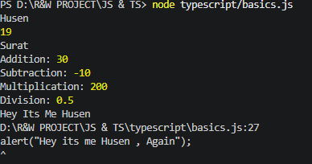
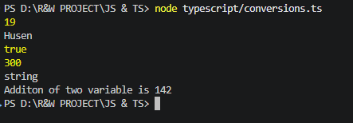
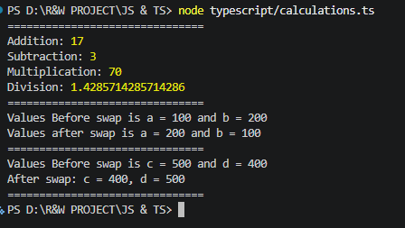
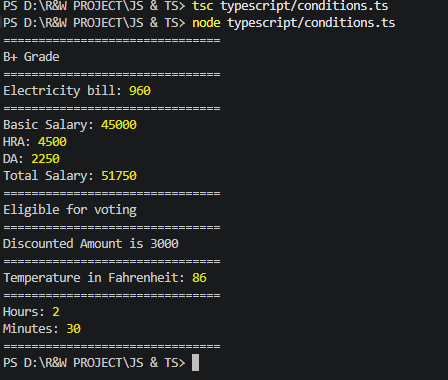

# 💻 TypeScript – 20 Practical Programs

A collection of **20 beginner-friendly TypeScript programs** demonstrating fundamental programming concepts, including variables, data types, operators, type conversion, conditional statements, calculations, and basic problem-solving.

This project contains practical programs written in TypeScript, along with their compiled JavaScript files, an HTML page for browser-based output, and screenshots demonstrating the program outputs.

---

## 📌 Project Overview

This project covers 20 practical questions designed to build a strong foundation in TypeScript programming.

### Concepts Covered

* Variables and Data Types
* `console.log()`, `alert()`, and `innerHTML`
* Arithmetic Operations
* Mathematical Calculations
* TypeScript Data Types
* The `any` Type
* Type Conversion
* Swapping Variables
* Conditional Statements (`if-else`)
* Grade Calculation
* Electricity Bill Calculation
* Salary Calculation
* Voting Eligibility
* Discount Calculation
* Temperature Conversion
* Time Conversion

---

## 🛠️ Technologies Used

* **Language:** TypeScript
* **Compiled Language:** JavaScript
* **Markup:** HTML
* **IDE:** Visual Studio Code
* **Runtime:** Node.js
* **Compiler:** TypeScript (`tsc`)
* **Version Control:** Git and GitHub

---

# 📚 Practical Questions

## 1. Personal Information Using `console.log()`

Write a TypeScript program to declare your name, age, and city, and display them using `console.log()`.

### Concepts Used

* Variable Declaration
* String and Number Values
* Console Output

---

## 2. Arithmetic Operations

Write a program to declare two numbers and display their addition, subtraction, multiplication, and division.

### Operations

1. Addition
2. Subtraction
3. Multiplication
4. Division

### Concepts Used

* Variables
* Arithmetic Operators
* Console Output

---

## 3. Display Messages Using Different Methods

Write a program to display one message using three different output methods.

### Methods Used

1. `console.log()`
2. `alert()`
3. `innerHTML`

### Concepts Used

* Console Output
* Browser Alerts
* HTML DOM Manipulation

**Note:** `alert()` and `innerHTML` require a browser environment.

---

## 4. Square and Cube of a Number

Write a program to store one number and calculate its square and cube.

### Formulas

* Square = Number × Number
* Cube = Number × Number × Number

### Concepts Used

* Variables
* Arithmetic Operators
* Mathematical Calculations

---

## 5. Area of a Rectangle

Write a program to calculate the area of a rectangle using its length and width.

### Formula

`Area = Length × Width`

### Concepts Used

* Variables
* Multiplication
* Mathematical Formulas

---

## 6. TypeScript Data Types

Write a program demonstrating different TypeScript data types.

### Data Types Used

* `number`
* `string`
* `boolean`

### Concepts Used

* Type Annotations
* Variable Declaration
* Basic TypeScript Data Types

---

## 7. Using the `any` Type

Write a program to declare one variable using the `any` type and assign different values to it one by one.

### Concepts Used

* The `any` Type
* Variable Reassignment
* TypeScript Type System

---

## 8. Convert String to Number

Write a program to convert the string `"250"` into a number and add `50` to it.

### Example

`"250" → 250 → 300`

### Concepts Used

* Type Conversion
* `Number()`
* Arithmetic Operations

---

## 9. Convert Number to String

Write a program to convert the number `500` into a string and display its type.

### Concepts Used

* Type Conversion
* `String()`
* `typeof` Operator

---

## 10. Numeric Addition After String Conversion

Write a program to take two string numbers, convert them into numbers, and perform numeric addition.

### Concepts Used

* String Variables
* Number Conversion
* Numeric Addition

---

## 11. Perform All Arithmetic Operations

Write a program to perform all arithmetic operations on two numbers.

### Operations

1. Addition (`+`)
2. Subtraction (`-`)
3. Multiplication (`*`)
4. Division (`/`)
5. Modulus (`%`)

### Concepts Used

* Arithmetic Operators
* Variables
* Console Output

---

## 12. Swap Two Numbers Using a Third Variable

Write a program to swap two numbers using a third variable.

### Example

Before swapping: `a = 10, b = 20`

After swapping: `a = 20, b = 10`

### Concepts Used

* Variables
* Assignment
* Temporary Variable

---

## 13. Swap Two Numbers Without a Third Variable

Write a program to swap two numbers without using a third variable.

### Concepts Used

* Arithmetic Operations
* Variable Assignment
* Swapping Logic

---

## 14. Student Grade Calculation

Write a program to determine a student's grade based on marks.

### Grading Criteria

| Marks        | Grade |
| ------------ | ----- |
| 80 and above | A     |
| 60 to 79     | B     |
| Below 60     | C     |

### Concepts Used

* `if-else`
* Comparison Operators
* Conditional Statements

---

## 15. Electricity Bill Calculation

Write a program to calculate an electricity bill based on the number of units consumed.

### Electricity Rates

| Units Consumed  | Rate        |
| --------------- | ----------- |
| Up to 100 units | ₹5 per unit |
| Above 100 units | ₹8 per unit |

### Concepts Used

* Conditional Statements
* Arithmetic Operations
* Bill Calculation

**Note:** The program applies the rate according to the selected usage category.

---

## 16. Employee Salary Calculation

Write a program to calculate an employee's total salary using basic salary, HRA, and DA.

### Salary Components

* Basic Salary: Given amount
* HRA: 10% of Basic Salary
* DA: 5% of Basic Salary

### Formula

`Total Salary = Basic Salary + HRA + DA`

### Concepts Used

* Percentage Calculation
* Arithmetic Operations
* Variables

---

## 17. Voting Eligibility

Write a program to check whether a person is eligible to vote based on their age.

### Concepts Used

* Conditional Statements
* Comparison Operators
* `if-else`

---

## 18. Discount Calculation

Write a program to calculate a discount based on the purchase amount.

### Discount Criteria

| Purchase Amount | Discount |
| --------------- | -------- |
| Above ₹5000     | 15%      |
| ₹5000 or below  | 5%       |

### Formulas

`Discount = Purchase Amount × Discount Percentage / 100`

`Final Price = Purchase Amount − Discount`

### Concepts Used

* Conditional Statements
* Percentage Calculation
* Arithmetic Operations

---

## 19. Celsius to Fahrenheit Conversion

Write a program to convert temperature from Celsius to Fahrenheit.

### Formula

`Fahrenheit = (Celsius × 9 / 5) + 32`

### Concepts Used

* Variables
* Arithmetic Operations
* Mathematical Formulas

---

## 20. Convert Minutes into Hours and Minutes

Write a program to convert a given number of minutes into hours and remaining minutes.

### Example

Input: `150 minutes`

Output:

* Hours: `2`
* Remaining Minutes: `30`

### Concepts Used

* Division
* Modulus (`%`)
* `Math.floor()`
* Mathematical Calculations

---

# 🖥️ Program Outputs

The following screenshots demonstrate the outputs of the practical programs.

### Questions 1–6: Basic Programs



### Questions 7–9: Type Conversion



### Questions 11–13: Arithmetic Operations and Swapping



### Questions 14–20: Conditional Statements and Calculations



---

# 📂 Project Structure

```text
JS & TS/
│
├── javascript/
│
├── typescript/
│   ├── basics.html
│   ├── basics.ts
│   ├── basics.js
│   │
│   ├── conversions.ts
│   ├── conversions.js
│   │
│   ├── calculations.ts
│   ├── calculations.js
│   │
│   ├── conditions.ts
│   ├── conditions.js
│   │
│   └── outputs/
│       ├── q1-6.png
│       ├── q7-q9.png
│       ├── q11-q13.png
│       └── q14-20.png
│
├── .gitignore
├── package.json
├── package-lock.json
└── README.md
```

**Note:** The `javascript/` folder is currently empty. The JavaScript files inside `typescript/` are the compiled versions of their corresponding TypeScript files.

The `node_modules/` folder is excluded from Git using `.gitignore`.

---

# ▶️ How to Run

## 1. Open the Project

Open the `JS & TS` folder in Visual Studio Code.

## 2. Open the Terminal

Open the integrated terminal in VS Code and navigate to the project root if necessary.

## 3. Compile TypeScript

Compile an individual TypeScript file using:

```bash
npx tsc typescript/basics.ts
```

Similarly, compile the other files:

```bash
npx tsc typescript/conversions.ts
npx tsc typescript/calculations.ts
npx tsc typescript/conditions.ts
```

The compiler generates the corresponding JavaScript files.

## 4. Run Programs Using Node.js

Run programs that use console output with:

```bash
node typescript/basics.js
```

You can also run the other compiled files:

```bash
node typescript/conversions.js
node typescript/calculations.js
node typescript/conditions.js
```

**Important:** Programs that use browser-specific features such as `alert()` and `document.getElementById()` should be executed in a browser rather than directly through Node.js.

## 5. Run the HTML Program

Open `typescript/basics.html` in a web browser to view the browser-based output.

Ensure that the HTML file references the compiled JavaScript file correctly:

```html
<script src="./basics.js"></script>
```

---

# 🎯 Project Objectives

The objectives of this project are to:

* Understand the fundamentals of TypeScript.
* Learn variable declaration and data types.
* Perform arithmetic calculations and type conversions.
* Understand the difference between strings and numbers.
* Implement conditional statements and comparison operators.
* Solve basic mathematical and logical problems.
* Calculate grades, electricity bills, salaries, and discounts.
* Convert temperature and time units.
* Understand the relationship between TypeScript, JavaScript, and HTML.
* Learn to compile and execute TypeScript programs.

---

# 👨‍💻 Conclusion

This project demonstrates 20 practical TypeScript programs covering fundamental programming concepts and everyday calculations.

By completing these exercises, beginners can develop a better understanding of variables, data types, operators, type conversion, conditional statements, and problem-solving techniques using TypeScript.

---
